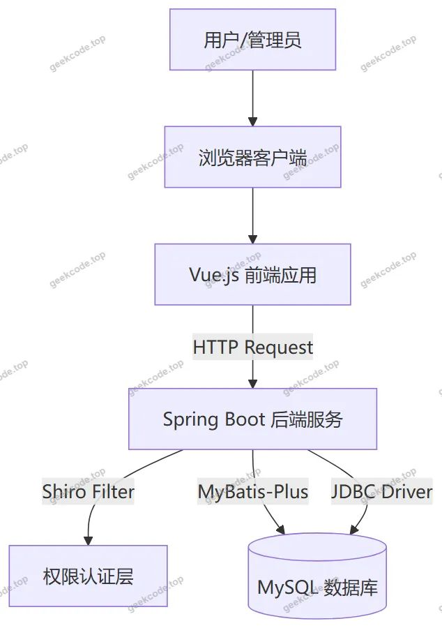
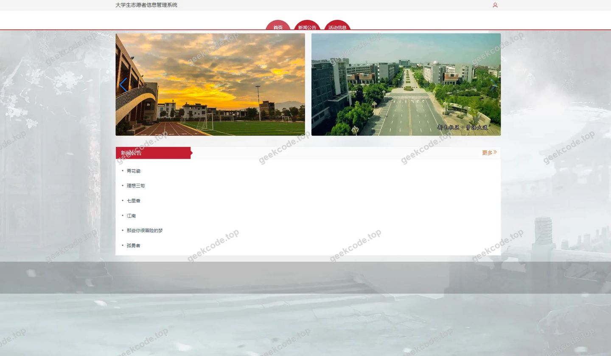
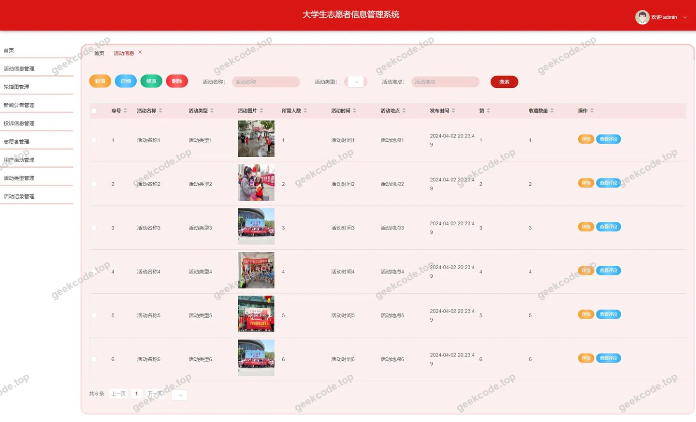
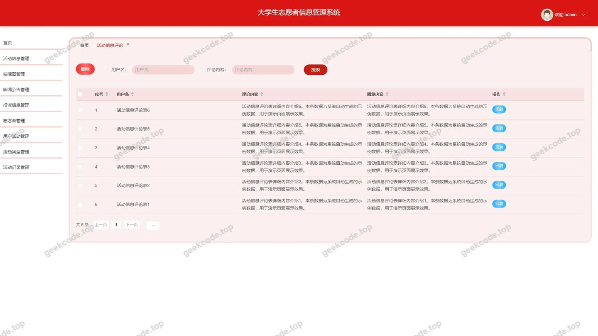
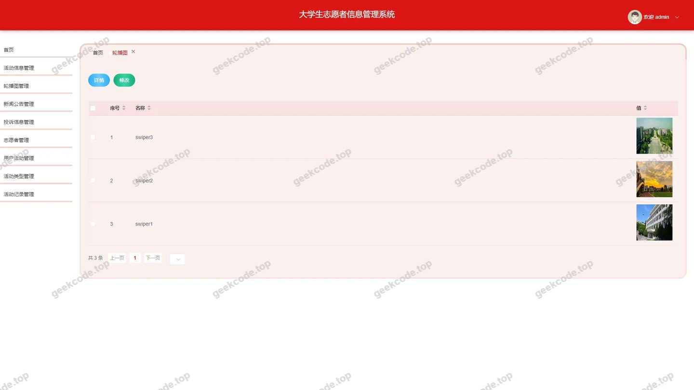
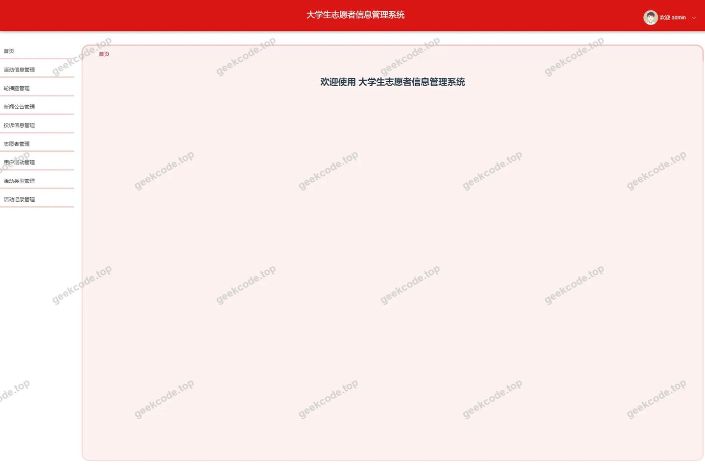
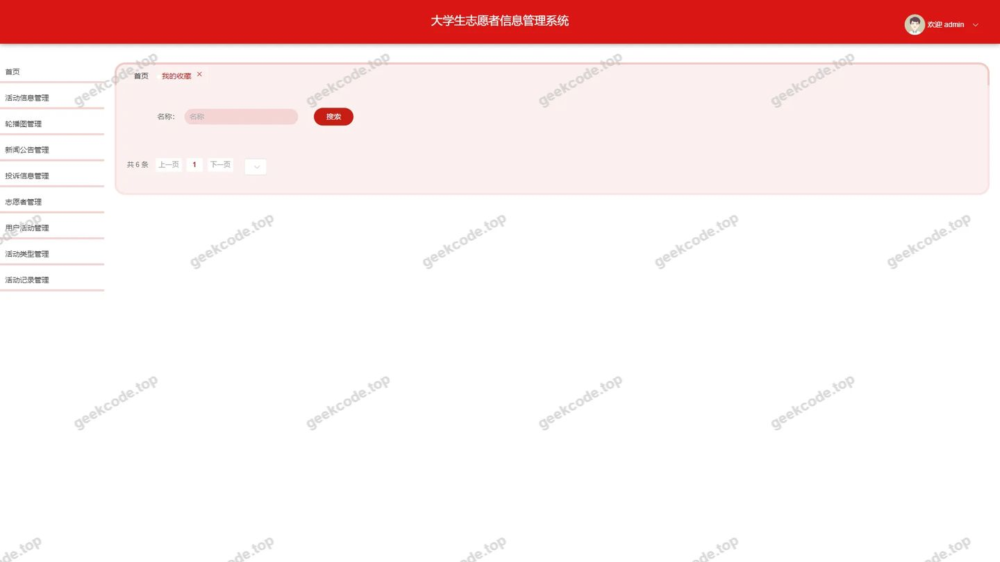
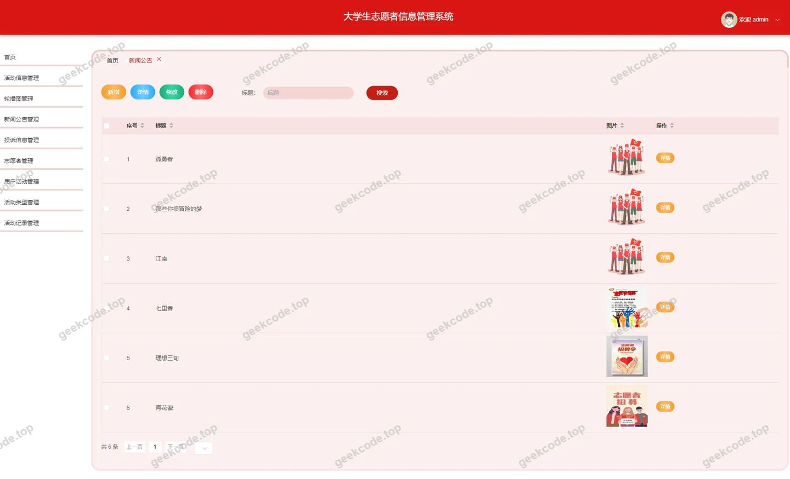
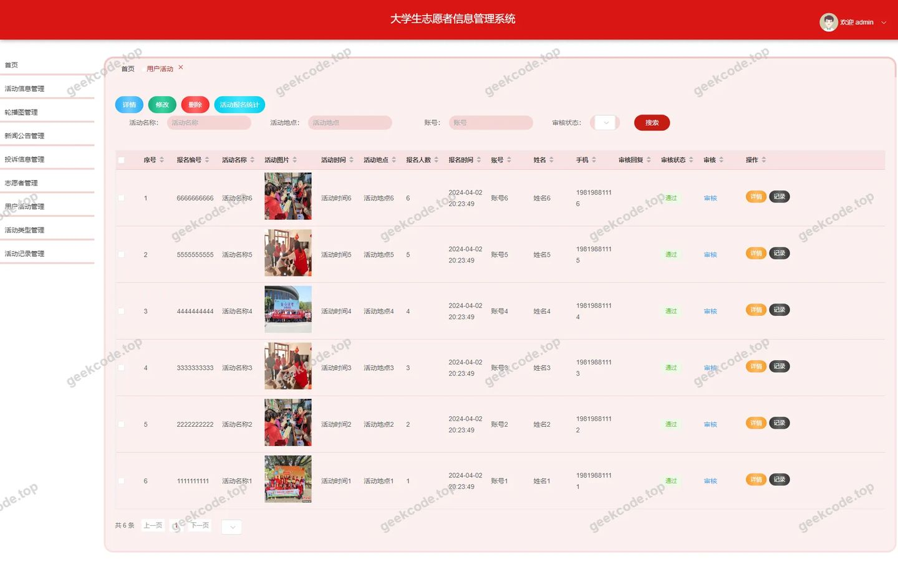

# [springboot]大学生志愿者信息管理系统

> 🎓 **计算机毕业设计 · [springboot]大学生志愿者信息管理系统**
>
> 本仓库只放**项目介绍 + 运行截图**（截图是站点带水印的原图，存在仓库 `images/` 里）。
>
> 👉 **完整可运行源码 / 数据库脚本 / 部署文档：[点我获取](https://geekcode.top/archives/springboot-%E5%A4%A7%E5%AD%A6%E7%94%9F%E5%BF%97%E6%84%BF%E8%80%85%E4%BF%A1%E6%81%AF%E7%AE%A1%E7%90%86%E7%B3%BB%E7%BB%9F?utm_source=github)**
>
> 💬 咨询微信：**ir9372**　|　🌐 更多项目：[极客代码 geekcode.top](https://geekcode.top/?utm_source=github)
>
> 📌 项目详情页：<https://geekcode.top/archives/springboot-%E5%A4%A7%E5%AD%A6%E7%94%9F%E5%BF%97%E6%84%BF%E8%80%85%E4%BF%A1%E6%81%AF%E7%AE%A1%E7%90%86%E7%B3%BB%E7%BB%9F?utm_source=github>

<table><td width="230" align="center"> <b>扫码加微信 ir9372</b></td><td valign="middle">📦 源码 = 项目介绍 + 全部运行截图 + 数据库 + 部署文档 👉 点上方任意截图，直接跳到 <b>极客代码 geekcode.top</b> 详情页</td></table>

---

<h1>[springboot]大学生志愿者信息管理系统</h1>
<h2>项目概述</h2>

本项目为“大学生志愿者信息管理系统”，旨在通过数字化手段优化高校志愿服务活动的组织与管理流程。系统采用前后端分离架构，核心功能涵盖志愿者注册管理、活动信息发布与报名、活动记录追踪、投诉反馈处理以及新闻公告展示等模块。适用于高校团委、学生社团及志愿者协会，解决传统纸质化管理效率低、数据分散、统计困难等问题。技术架构上，后端基于 Spring Boot 框架结合 MyBatis-Plus 实现高效数据持久化，使用 Shiro 进行权限控制；前端采用 Vue 框架构建用户界面，提供流畅的交互体验。系统分为前台用户端与后台管理端，分别服务于普通志愿者/学生群体与管理员角色，实现了业务闭环与信息透明化。

<h2>技术架构</h2>
<h3>1. 总体架构设计</h3>

系统采用经典的 B/S（浏览器/服务器）架构，遵循前后端分离的设计模式。

<h3>2. 核心技术选型理由</h3>
<ul>
<li><strong>后端框架 (Spring Boot)</strong>：作为 Java 生态中最流行的微服务基础框架，Spring Boot 提供了自动配置和起步依赖，极大地简化了项目的搭建与部署过程。其内置的 Tomcat 容器使得独立运行成为可能，适合中小型管理系统快速开发。</li>
<li><strong>数据持久层 (MyBatis-Plus)</strong>：在 MyBatis 的基础上增强了 CRUD 操作，提供了通用的 Mapper 接口和条件构造器，减少了大量样板代码的编写，提升了开发效率。配合 <code>mybatis-spring-boot-starter</code> 实现无缝集成。</li>
<li><strong>安全框架 (Apache Shiro)</strong>：用于处理身份验证、授权、加密和会话管理。相较于其他复杂的安全框架，Shiro 轻量级且易于理解，能够满足本系统对于管理员与普通用户不同权限等级的控制需求。</li>
<li><strong>前端技术 (Vue.js)</strong>：虽然源码主要展示了后端逻辑，但根据“vue-integrated”类型及路由结构推断，前端采用了 Vue 框架构建单页应用（SPA）。Vue 的响应式数据绑定和组件化开发模式，使得复杂的表单录入（如志愿者注册、活动发布）和数据列表展示更加直观高效。</li>
<li><strong>数据库 (MySQL)</strong>：选用 MySQL 作为关系型数据库，因其开源免费、性能稳定且社区支持广泛，完全满足志愿者信息、活动记录等结构化数据的存储需求。</li>
</ul>
<h3>3. 数据库设计要点</h3>

系统数据模型围绕“人”、“事”、“物”展开：

<ul>
<li><strong>实体表</strong>：包括 <code>zhiyuanzhe</code>（志愿者信息）、<code>huodongxinxi</code>（活动详细信息）、<code>huodongleixing</code>（活动分类）、<code>news</code>（新闻公告）、<code>tousuxinxi</code>（投诉信息）、<code>huodongjilu</code>（活动参与记录）、<code>storeup</code>（收藏信息）等。</li>
<li><strong>关联关系</strong>：通过外键或中间字段关联志愿者与活动，实现多对多的报名与参与关系；评论表 <code>discusshuodongxinxi</code> 关联具体活动，支持互动反馈。</li>
<li><strong>配置表</strong>：<code>config</code> 表用于存储轮播图、系统参数等动态配置信息，便于后台统一管理前端展示内容。</li>
</ul>
<h2>功能模块</h2>

根据提供的路由与截图信息，系统功能划分为前台用户端与后台管理端两大部分。

<h3>1. 前台用户端功能</h3>

前台主要面向注册用户（志愿者/学生），提供信息浏览与个人事务处理功能。

<ul>
<li><strong>首页展示 (<code>/index/newsList</code>, <code>/index/zhiyuanzheList</code>)</strong>：</li>
<li>展示最新发布的新闻公告列表。</li>
<li>展示志愿者风采或公开志愿者列表。</li>
<li>呈现热门活动信息概览。</li>
<li><strong>志愿者管理 (<code>/index/zhiyuanzheAdd</code>, <code>/index/zhiyuanzheCenter</code>)</strong>：</li>
<li><strong>注册入口 (<code>/zhiyuanzheRegister</code>)</strong>：新用户填写基本信息完成注册。</li>
<li><strong>个人中心 (<code>/index/zhiyuanzheCenter</code>)</strong>：查看和修改个人资料。</li>
<li><strong>详情查看 (<code>/index/zhiyuanzheDetail</code>)</strong>：查看特定志愿者的公开档案。</li>
<li><strong>活动信息管理 (<code>/index/huodongxinxiList</code>, <code>/index/huodongxinxiAdd</code>)</strong>：</li>
<li><strong>活动列表</strong>：浏览所有已发布的志愿服务活动。</li>
<li><strong>活动详情</strong>：查看活动时间、地点、要求及报名状态。</li>
<li><strong>新增活动</strong>：具备相应权限的用户可提交新的活动申请或直接发布（视具体权限而定，路由存在 Add 接口）。</li>
<li><strong>活动类型查询 (<code>/index/huodongleixingList</code>, <code>/index/huodongleixingDetail</code>)</strong>：</li>
<li>按类别（如支教、环保、社区服务等）筛选活动。</li>
<li>查看特定类型的介绍与相关活动。</li>
<li><strong>用户参与活动 (<code>/index/yonghuhuodongList</code>, <code>/index/yonghuhuodongAdd</code>)</strong>：</li>
<li>查看自己报名或参与的活动列表。</li>
<li>执行报名操作或取消报名。</li>
<li><strong>活动记录 (<code>/index/huodongjiluList</code>, <code>/index/huodongjiluAdd</code>)</strong>：</li>
<li>记录个人志愿服务时长或参与凭证。</li>
<li>查看历史活动参与详情。</li>
<li><strong>投诉与建议 (<code>/index/tousuxinxiList</code>, <code>/index/tousuxinxiAdd</code>)</strong>：</li>
<li>提交关于活动组织或服务质量的投诉。</li>
<li>查看投诉处理进度。</li>
<li><strong>我的收藏 (<code>/index/storeupList</code>)</strong>：</li>
<li>查看收藏夹中的感兴趣活动或文章。</li>
</ul>
<h3>2. 后台管理端功能</h3>

后台面向系统管理员，负责全局数据的维护、审核与配置。

<ul>
<li><strong>登录与仪表盘 (<code>/admin/login</code>, <code>/page/home</code>)</strong>：</li>
<li>管理员身份验证。</li>
<li>查看系统概况统计（根据截图“页面-首页(admin)”推断）。</li>
<li><strong>轮播图管理 (<code>/config</code>)</strong>：</li>
<li>配置前台首页展示的轮播图片，支持增删改查及排序。</li>
<li><strong>新闻公告管理 (<code>/news</code>)</strong>：</li>
<li>发布、编辑、删除官方新闻与通知。</li>
<li>控制新闻的前台可见性。</li>
<li><strong>活动信息管理 (<code>/huodongxinxi</code>)</strong>：</li>
<li>审核用户提交的活动。</li>
<li>直接创建、编辑、删除活动条目。</li>
<li>管理活动状态（进行中、已结束等）。</li>
<li><strong>活动评论管理 (<code>/discusshuodongxinxi</code>)</strong>：</li>
<li>查看用户对活动的评论。</li>
<li>审核或删除违规评论。</li>
<li><strong>用户活动管理 (<code>/yonghuhuodong</code>)</strong>：</li>
<li>监控用户的报名情况。</li>
<li>处理异常报名数据。</li>
<li><strong>志愿者信息管理 (<code>/zhiyuanzhe</code>)</strong>：</li>
<li>审核新注册的志愿者资料。</li>
<li>管理志愿者账号状态（启用/禁用）。</li>
<li>查询志愿者详细档案。</li>
<li><strong>活动类型管理 (<code>/huodongleixing</code>)</strong>：</li>
<li>定义和维护志愿服务的分类标签。</li>
<li><strong>活动记录管理 (<code>/huodongjilu</code>)</strong>：</li>
<li>核查志愿者提交的工时记录。</li>
<li>批量导入或修正活动参与数据。</li>
<li><strong>投诉信息管理 (<code>/tousuxinxi</code>)</strong>：</li>
<li>接收并处理用户投诉。</li>
<li>标记投诉状态（待处理、已解决、已关闭）。</li>
<li><strong>收藏管理 (<code>/storeup</code>)</strong>：</li>
<li>查看全站用户的收藏行为数据，用于分析热点活动。</li>
</ul>
<h2>用户角色与权限</h2>

基于 Shiro 框架的路由隔离与菜单结构，系统主要包含两类角色：<strong>普通用户（志愿者）</strong> 和 <strong>系统管理员</strong>。

<h3>1. 普通用户（志愿者/学生）</h3>
<ul>
<li><strong>权限范围</strong>：仅限前台访问及个人数据操作。</li>
<li><strong>可访问功能模块</strong>：</li>
<li><strong>公共浏览</strong>：首页新闻、活动列表、活动类型、志愿者风采。</li>
<li><strong>个人事务</strong>：</li>
<li>注册与登录。</li>
<li>个人中心资料维护。</li>
<li>活动报名与取消。</li>
<li>提交活动参与记录。</li>
<li>提交投诉建议。</li>
<li>管理个人收藏。</li>
<li><strong>限制</strong>：无法访问后台管理路由（如 <code>/admin/*</code>），无法删除他人数据，无法审核内容。</li>
</ul>
<h3>2. 系统管理员</h3>
<ul>
<li><strong>权限范围</strong>：拥有最高权限，可访问后台所有管理模块及部分前台配置功能。</li>
<li><strong>可访问功能模块</strong>：</li>
<li><strong>内容管理</strong>：新闻公告、轮播图配置、活动类型定义。</li>
<li><strong>业务审核与维护</strong>：</li>
<li>志愿者账号管理与审核。</li>
<li>活动信息的发布、编辑与删除。</li>
<li>用户报名记录的监控与管理。</li>
<li>活动参与记录的核实与修正。</li>
<li><strong>互动管理</strong>：</li>
<li>活动评论的审核与清理。</li>
<li>投诉信息的受理与回复。</li>
<li><strong>数据分析</strong>：查看收藏数据、用户活动分布等。</li>
<li><strong>限制</strong>：通常不直接参与前台的业务报名流程，而是以管理者身份介入。</li>
</ul>

<em>(注：根据现有路由 <code>/zhiyuanzheAdd</code> 和 <code>/huodongxinxiAdd</code> 在前台的存在，推测部分高级用户或特定场景下允许用户自行添加活动或志愿者信息，但需经过后台 <code>/zhiyuanzhe</code> 和 <code>/huodongxinxi</code> 的审核机制。)</em>

<h2>项目特色与创新点</h2>
<ol>
<li>
<strong>全流程数字化闭环</strong>：
   系统覆盖了从志愿者招募（注册）、活动发布、在线报名、现场参与记录、事后评价（评论/投诉）到数据统计的全生命周期。相比传统线下管理模式，极大降低了沟通成本和管理误差。

</li>
<li>
<strong>灵活的内容管理体系</strong>：
   引入了“活动类型”与“新闻公告”的双轨制内容管理。管理员可以通过 <code>config</code> 模块动态调整首页轮播图，通过 <code>huodongleixing</code> 模块精细化分类志愿活动，提升了信息检索效率和用户体验。

</li>
<li>
<strong>双向反馈机制</strong>：
   不仅支持管理员发布信息，还通过 <code>discusshuodongxinxi</code>（活动评论）和 <code>tousuxinxi</code>（投诉信息）建立了用户向管理方的反馈通道。这种机制有助于及时发现活动组织中的问题，提升志愿服务质量。

</li>
<li>
<strong>轻量化与安全并重</strong>：
   采用 Shiro 而非更沉重的 Spring Security，在保证权限控制严谨性的同时，降低了系统的资源占用和复杂度，非常适合校园内网环境下的快速部署与维护。MyBatis-Plus 的使用则大幅减少了 SQL 拼接风险，提高了代码的可读性和安全性。

</li>
<li>
<strong>个人成长档案可视化</strong>：
   通过 <code>huodongjilu</code>（活动记录）和 <code>storeup</code>（收藏）模块，为每位志愿者构建了可视化的服务档案。这不仅便于学校统计志愿服务时长，也为志愿者个人的社会实践证明提供了数据支撑。

</li>
</ol>
<h2>部署环境</h2>

为确保系统正常运行，需准备以下软硬件环境：

<h3>1. 硬件环境</h3>
<ul>
<li><strong>服务器</strong>：建议配置 CPU 2核及以上，内存 4GB 及以上，硬盘空间 20GB 以上（用于存放数据库备份及上传的图片资源）。</li>
<li><strong>客户端</strong>：任意支持现代浏览器（Chrome, Firefox, Edge, Safari）的 PC 或移动设备。</li>
</ul>
<h3>2. 软件环境</h3>
<ul>
<li><strong>操作系统</strong>：Windows Server, Linux (CentOS/Ubuntu), macOS 均可。</li>
<li><strong>Java 运行环境</strong>：JDK 1.8 或更高版本（推荐 JDK 1.8，兼容性好）。</li>
<li><strong>数据库</strong>：MySQL 5.7 或 MySQL 8.0+。需安装 JDBC 驱动 <code>mysql-connector-java</code>。</li>
<li><strong>Web 服务器</strong>：Spring Boot 内置 Tomcat，无需额外安装外部 Web 服务器；若生产环境高并发，建议前置 Nginx 做反向代理。</li>
<li><strong>前端构建工具</strong>：Node.js (LTS 版本)，npm 或 yarn，用于编译 Vue 前端项目。</li>
<li><strong>Maven</strong>：3.6+ 版本，用于后端项目依赖管理与打包。</li>
</ul>
<h3>3. 启动步骤简述</h3>
<ol>
<li>初始化 MySQL 数据库，执行建表脚本。</li>
<li>配置 <code>application.yml</code> 或 <code>application.properties</code> 中的数据库连接 URL、用户名和密码。</li>
<li>使用 Maven 命令 <code>mvn clean package</code> 打包后端项目，生成 jar 包。</li>
<li>运行 <code>java -jar xxx.jar</code> 启动后端服务。</li>
<li>进入前端目录，执行 <code>npm install</code> 安装依赖，然后 <code>npm run build</code> 生成静态文件，或直接 <code>npm run serve</code> 进行本地调试。</li>
<li>将前端静态文件部署至 Nginx 或 Spring Boot 静态资源目录，或通过开发服务器代理访问。</li>
</ol>
<h2>五、技术特性</h2>
<ul>
<li>前后端集成部署，前端资源打包至后端 static 目录</li>
<li>使用 MyBatis-Plus 简化数据访问层开发</li>
<li>集成 Shiro 权限框架实现角色权限控制</li>
</ul>
<h2>六、功能模块截图</h2>
<h3>前台用户端</h3>
<h4>前台-首页</h4>

<h4>前台-登录</h4>

<h4>前台-zhiyuanzhe注册</h4>

<h3>后台管理端</h3>
<h4>后台-登录页</h4>

<h4>后台-活动信息</h4>

<h4>后台-活动信息评论</h4>

<h4>后台-轮播图</h4>

<h4>页面-首页</h4>

<h4>后台-我的收藏</h4>

<h4>后台-新闻公告</h4>

<h4>后台-用户活动</h4>

---

## 获取完整源码

| 项目 | 说明 |
| --- | --- |
| 项目名 | [springboot]大学生志愿者信息管理系统 |
| 运行截图 | 本文 12 张（站点带水印原图，仓库 `images/` 目录） |
| 完整源码 | [https://geekcode.top/archives/springboot-%E5%A4%A7%E5%AD%A6%E7%94%9F%E5%BF%97%E6%84%BF%E8%80%85%E4%BF%A1%E6%81%AF%E7%AE%A1%E7%90%86%E7%B3%BB%E7%BB%9F?utm_source=github](https://geekcode.top/archives/springboot-%E5%A4%A7%E5%AD%A6%E7%94%9F%E5%BF%97%E6%84%BF%E8%80%85%E4%BF%A1%E6%81%AF%E7%AE%A1%E7%90%86%E7%B3%BB%E7%BB%9F?utm_source=github) |
| 咨询微信 | **ir9372**（备注：jingpin-yuanma） |
| 更多项目 | [极客代码 geekcode.top](https://geekcode.top/?utm_source=github) |

> 需要源码、部署、改配置、跑不起来等问题，加微信 ir9372 沟通，说明项目名即可。
